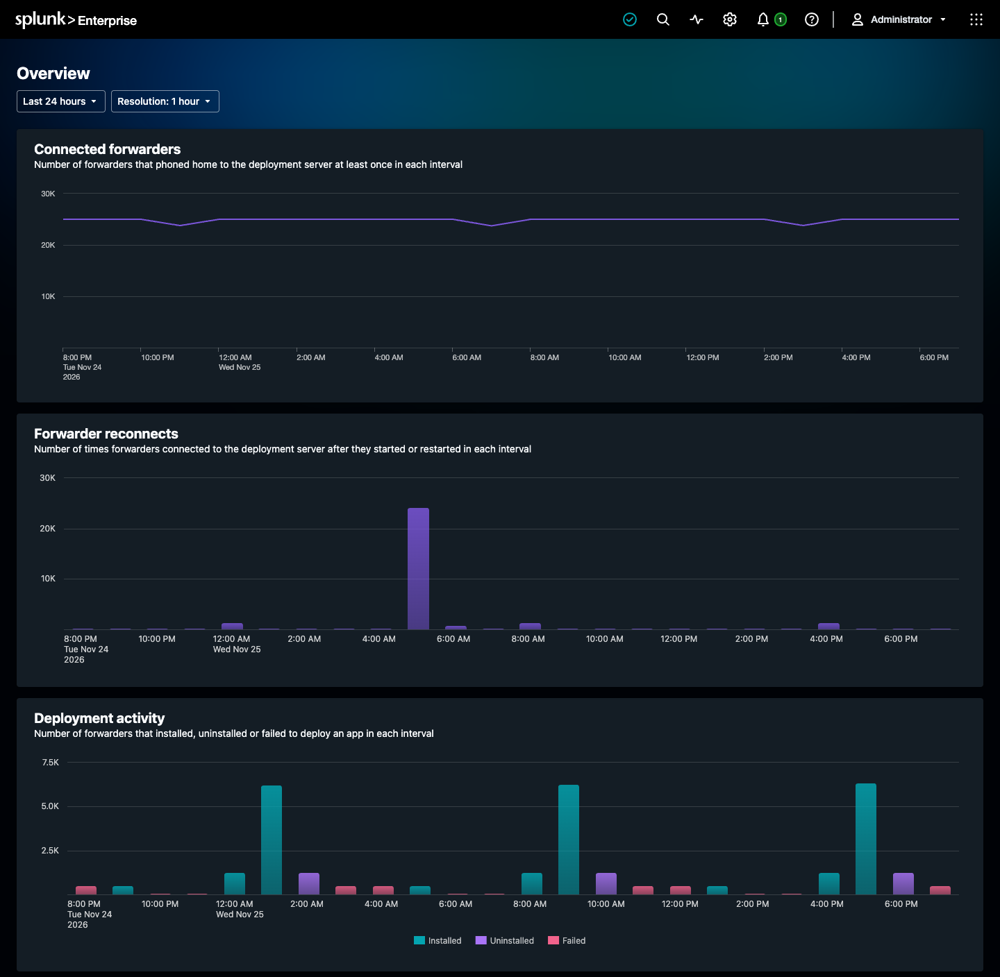
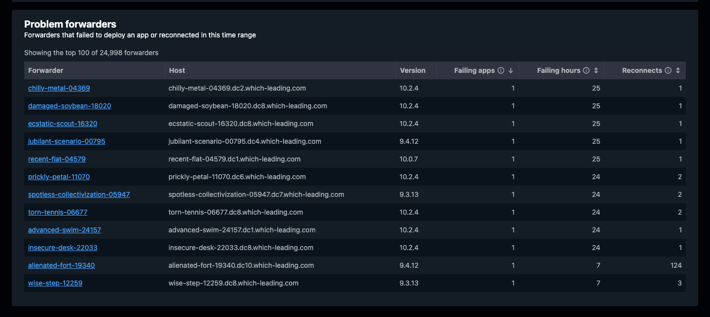
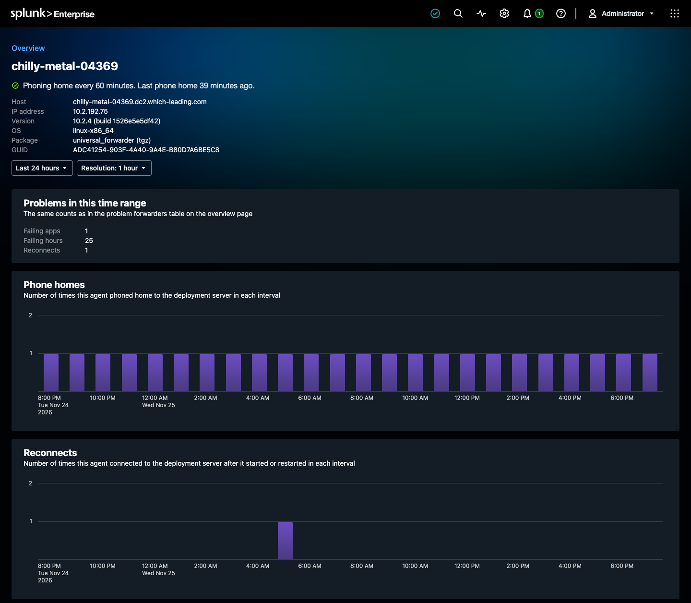
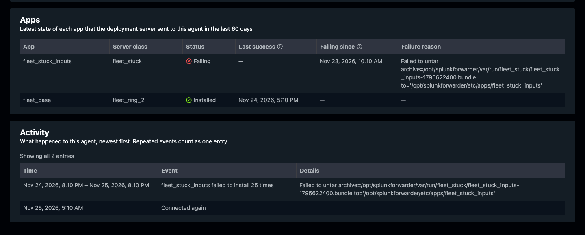

# Fleet Overview

Fleet Overview is a Splunk app for monitoring forwarders connected to a deployment server and
investigating app deployment failures. The screenshots show simulated fleet data.

## Fleet overview

- **Connected forwarders** shows how many forwarders phoned home in each interval.
- **Forwarder reconnects** shows how often forwarders reconnected after starting or restarting.
- **Deployment activity** shows how many forwarders installed, uninstalled, or failed to deploy an
  app in each interval.

Choose a time range and an automatic or fixed chart resolution. Share the page URL to keep those
selections. The app follows your Splunk light or dark theme preference.

## Problem forwarders

Find the top 100 forwarders with deployment failures or reconnects in the selected time range.
Rank them by failing apps, hours with deployment failures, or reconnects. Select a forwarder to
open its details with the same time range and resolution.

## Agent details

See a forwarder's host, IP address, version, platform, and phone-home status. Review its problem
counts and chart its phone homes and reconnects over the selected time range.

### Apps and activity

Check the latest deployment status of each app by server class, including its last successful
deployment, when it started failing, and the failure reason. Review recent reconnects and app
changes in the activity timeline, which groups repeated events.

